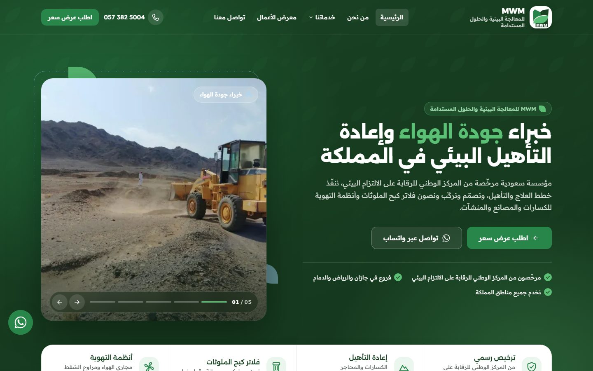
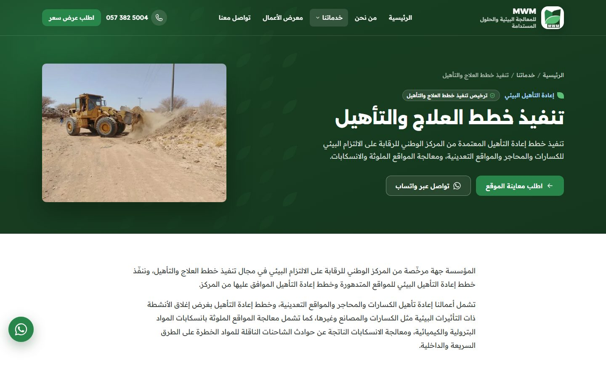
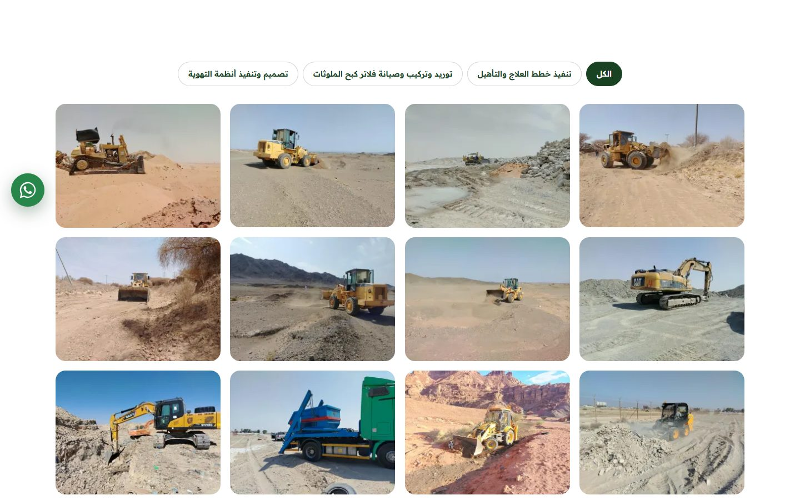
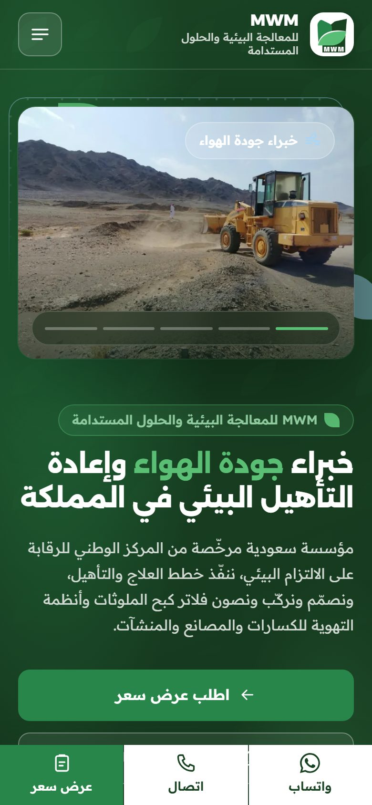
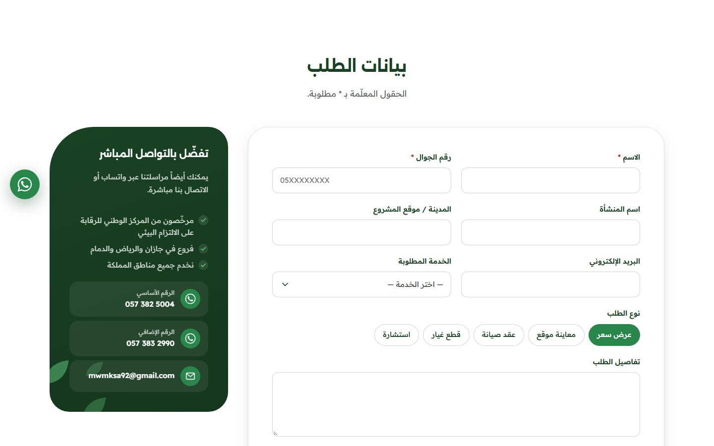
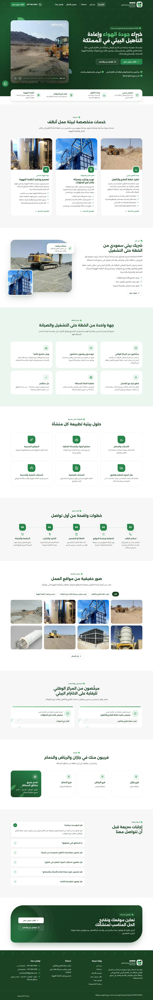

# MWM — WordPress Theme

Custom RTL-first WordPress theme for **MWM للمعالجة البيئية والحلول المستدامة**
(MWM Environmental Remediation & Sustainable Solutions) — a Saudi environmental services establishment
licensed by the National Center for Environmental Compliance (NCEC), with branches in Jazan, Riyadh and Dammam.

The site presents three licensed service lines — remediation & rehabilitation plans, pollution-control filters
and ventilation systems — and turns B2B visitors (crushers, block and ready-mix plants, factories) into
WhatsApp chats, calls and quote / site-visit requests.

Built on **Elementor Free** + **ACF Free**: every page section, the header and the footer are Elementor widgets,
while business data (services, branches, licenses, FAQs, contacts) lives in custom post types and a settings screen.

<p align="center">
  
</p>

<div dir="rtl">

**بالعربي:** ثيم ووردبريس مخصص لمؤسسة MWM للمعالجة البيئية والحلول المستدامة، عربي من اليمين للشمال من الأساس. كل سكشن في الموقع — وكمان الهيدر والفوتر — ويدجت في الإليمنتور (المجانية) تقدر تعدّل نصوصه وصوره وألوانه من غير كود، ومعرض الأعمال بتاباته وصوره بيتعدّل من الإليمنتور مباشرة. البيانات الثابتة زي الخدمات والفروع والتراخيص والأرقام بتتعدّل من لوحة التحكم، والموقع متجاوب على كل المقاسات من الموبايل لحد الشاشات الكبيرة.

</div>

---

## Screenshots

| Service page | Work gallery | Mobile |
| --- | --- | --- |
|  |  |  |

| Quote request form |
| --- |
|  |

<details>
<summary>Full homepage</summary>
<p align="center"></p>
</details>

---

## Features

- **RTL Arabic first** — `dir="rtl"` from the WordPress locale and CSS logical properties throughout, not a flipped LTR layout. Strings use the `mwm` text domain, ready for an English version.
- **One Elementor widget per section** (category «MWM»): hero slider, page hero, text & media, service cards, service items, features, process steps, work gallery, licenses, branches & coverage, FAQ, call to action, contact details, quote form, free text.
- **Header & footer as Elementor templates without Pro** — dedicated header/footer widgets render the theme's own markup, so the client edits them visually while the sticky header, mobile drawer and design stay intact.
- **Ready-made layouts** — every page and service opens in Elementor already built with the same design, and a new service is prefilled automatically the first time it is edited.
- **Gallery tabs edited in Elementor** — each tab in the gallery widget is a filter button with its own images (add, rename, reorder tabs and photos). Native `<dialog>` lightbox with keyboard navigation.
- **One markup source** — each widget renders a theme template part (`template-parts/sections/*`), so pages still render from PHP when Elementor is off.
- **Quote / site-visit form with inbox** — submissions are saved under «طلبات العملاء» and emailed to the configured addresses. Nonce, honeypot, time trap and per-IP throttle; Saudi mobile validation; works without JavaScript.
- **Direct contact everywhere** — floating WhatsApp button with a number picker, a bottom contact bar on mobile, and click-to-call links, all driven by the settings screen.
- **SEO without plugins** — JSON-LD graph (Organization, WebSite, one LocalBusiness per branch, Service, BreadcrumbList), Open Graph and meta description per page; backs off automatically if Yoast or Rank Math is installed.
- **Performance** — no build step and no front-end libraries; self-hosted variable fonts with `font-display: swap`, WebP sub-sizes, lazy images, `content-visibility` for off-screen sections, one deferred script.
- **Accessibility** — WCAG 2.2 AA contrast, visible focus, keyboard-friendly menus and lightbox, one H1 per page, motion disabled under `prefers-reduced-motion`.
- **No hardcoded content** — logo, menus, phones, addresses, licenses, images and copy all come from WordPress. Empty fields hide their UI instead of showing placeholders.

## Requirements

| | Version |
| --- | --- |
| WordPress | 6.8+ |
| PHP | 8.2+ |
| [Elementor](https://wordpress.org/plugins/elementor/) (Free) | required for visual editing |
| [Advanced Custom Fields](https://wordpress.org/plugins/advanced-custom-fields/) (Free) | required for service / branch / license fields |

Developed and tested on WordPress 7.1, PHP 8.3, Elementor 4.3 and ACF 6.8 (Arabic locale).

## Installation

1. Copy `wp-content/themes/mwm/` into your site's `wp-content/themes/` (or zip that folder and upload it from *Appearance → Themes*).
2. Install and activate **Elementor** and **Advanced Custom Fields**.
3. Activate the **MWM** theme and set the site language to Arabic.
4. Fill in **إعدادات الموقع** (phones, email, socials, page roles), add services, branches and licenses, then edit pages in Elementor using the «MWM» widgets.

> This repository contains the theme only. WordPress core, plugins, the uploads folder and the database (pages, Elementor layouts, media) are not included.

## Where content is edited

| Content | Dashboard location |
| --- | --- |
| Services (summary, icon, highlights, button label, starting photos) | **الخدمات** |
| Service items (what each service includes) | **بنود الخدمات** |
| Branches (region, address, phone, email, hours, map link, optional coordinates) | **الفروع** |
| Licenses (issuer, number, dates, verification link, document, licensed services) | **التراخيص** |
| FAQs (optionally linked to a service) | **الأسئلة الشائعة** |
| Quote / contact submissions | **طلبات العملاء** |
| Phones, WhatsApp, email, CR / VAT numbers, company profile PDF | **إعدادات الموقع** |
| Header / footer templates, social links, page roles, form recipients | **إعدادات الموقع** (tabs) |
| Page sections, gallery tabs and photos | Elementor — «MWM» widgets |
| Logo, site icon, site name | Appearance → Customize → Site Identity |
| Menus | Appearance → Menus |

## Theme structure

```text
wp-content/themes/mwm/
├── style.css · functions.php · screenshot.png
├── header.php · footer.php · page.php · single-mwm_service.php · 404.php · …
├── inc/
│   ├── elementor/            # Mwm_Widget base + section, header and footer widgets
│   ├── elementor.php         # widget registration, «MWM» category
│   ├── elementor-config.php  # Kit colors & fonts, Elementor options
│   ├── elementor-layouts.php # ready-made page/service layouts, header/footer templates
│   ├── post-types.php        # services, service items, branches, licenses, FAQs, requests
│   ├── acf.php               # local ACF field groups
│   ├── settings.php          # «إعدادات الموقع» screen (Settings API)
│   ├── leads.php             # quote form handler + inbox
│   ├── seo.php               # JSON-LD, Open Graph, meta, sitemaps
│   ├── chrome.php            # header/footer template rendering
│   └── helpers.php · icons.php · enqueue.php · security.php · gallery-metabox.php
├── template-parts/
│   ├── sections/             # hero, services, gallery, licenses, branches, faq, quote-form, …
│   └── header/ · footer/
└── assets/
    ├── css/                  # tokens, base, layout, sections, motion, admin
    ├── js/theme.js           # slider, reveal, gallery filter, lightbox, drawer, form
    └── fonts/                # Alexandria + Readex Pro (variable woff2, OFL)
```

## Design tokens

| Token | Value | Use |
| --- | --- | --- |
| `--mwm-green` | `#28864B` | Primary — buttons, links, accents |
| `--mwm-deep` | `#194223` | Headings, dark surfaces, header & footer |
| `--mwm-leaf` | `#5BBF75` | Decorative shapes only (not text on white) |
| `--mwm-ink` | `#3A423C` | Body text |
| `--mwm-mist` | `#EAEAEA` | Light surfaces |
| `--mwm-sky` | `#A5D7FC` | Secondary accent, focus ring on dark |

Colors follow the MWM visual identity guide and are mirrored in Elementor's global colors, so changing them in Elementor updates the whole theme.
Fonts: **Alexandria** (headings) and **Readex Pro** (body), self-hosted variable fonts with Arabic and Latin subsets.

## Development notes

- Function prefix `mwm_`, text domain `mwm`; all output is escaped.
- Plain CSS and JavaScript — no bundler. CSS uses custom properties, logical properties, `clamp()` and cascade layers.
- Single service pages are PHP templates with an Elementor layout on top, since Elementor's Theme Builder requires Pro.
- `wp mwm seed` (WP-CLI) creates the initial pages, services and settings on a fresh install.

## License

[GPL v2 or later](https://www.gnu.org/licenses/gpl-2.0.html). Fonts are licensed under the SIL Open Font License 1.1.

Theme by [MohamedAmjad](https://mohamed-amjad.com).
